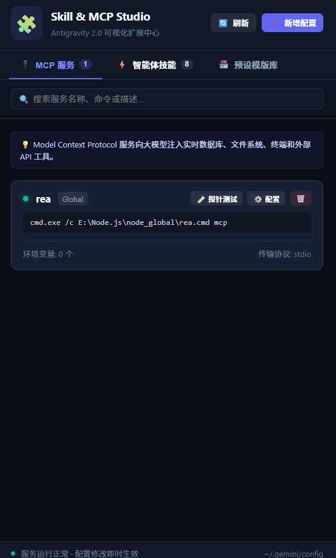
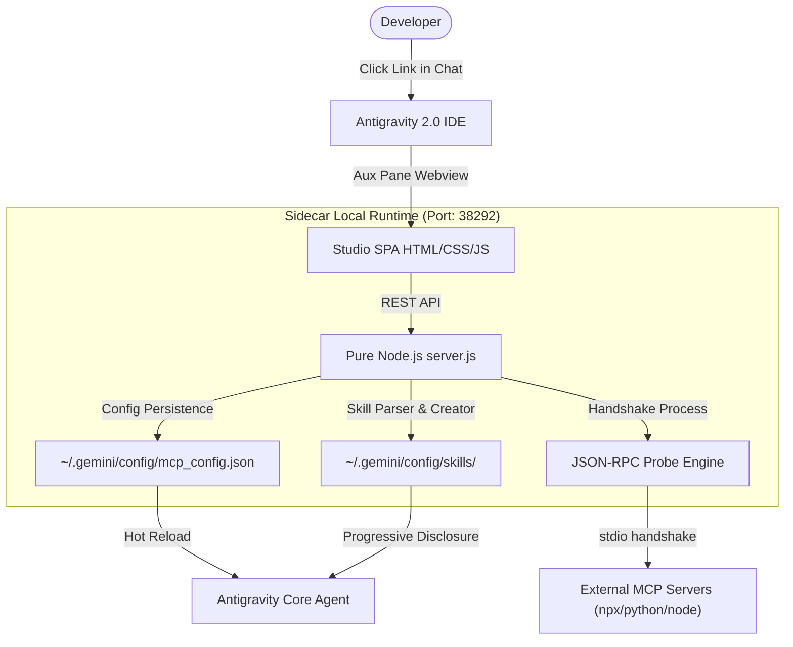

# Antigravity Skill & MCP Studio 🧩

<div align="center">

[](LICENSE)
[](https://github.com/google)
[](https://modelcontextprotocol.io/)
[](https://nodejs.org)
[](https://github.com)

**A visual sidebar control center & studio tailored for Google Antigravity 2.0**  
*Configure, probe-test, and manage MCP servers and Agent Skills directly inside a native GUI panel — zero command line, zero manual JSON editing!*

[Features](#-key-features) · [Quick Start](#-quick-start) · [Architecture](#-architecture) · [Template Store](#-template-store) · [中文文档](README.zh.md)

<br/>



</div>

---

## 💡 Why This Project?

When building with **Google Antigravity 2.0**, setting up Model Context Protocol (MCP) servers and Agent Skills has traditionally been clunky and error-prone:

1. **Tedious & Fragile JSON Editing**: Developers have had to handcraft `~/.gemini/config/mcp_config.json`. Escaping quotes, windows paths, or missing commas silently break the agent.
2. **Zero Visibility & Debugging**: No quick way to know if an MCP server successfully starts up, what tools it exposes, or why it crashed without grepping through process trees and debug logs.
3. **Manual Skill Authoring**: Creating custom skills required manually creating directory hierarchies, remembering YAML frontmatter syntax, and hand-copying files.

**Antigravity Skill & MCP Studio** solves this by implementing Antigravity's official Sidecar UI specification, bringing a beautiful, responsive studio panel right inside your IDE sidebar.

---

## ✨ Key Features

### 🔌 1. Visual MCP Server Manager
* **Pure GUI Form**: Add or edit servers with friendly form inputs for names, runtime selections (`npx`, `python`, `node`, `uvx`), arguments, and environment variables.
* **Live Handshake Probe Engine (🧪 探针测试)**:
  * Performs an instant background JSON-RPC stdio handshake (`initialize` -> `notifications/initialized` -> `tools/list`).
  * Displays round-trip **latency (ms)** and an expandable badge list of all discovered **tools and descriptions**.
* **Hot Persistence**: Instantly writes to `mcp_config.json` safely.

### ⚡ 2. Agent Skills Studio
* **Multi-Scope Discovery**: Automatically indexes Global skills (`~/.gemini/config/skills`), Built-in system skills, and current Workspace skills (`.agents/skills`).
* **In-App Markdown Editor**: Write guidance and runbooks with live preview; YAML frontmatter metadata is generated and parsed automatically.
* **Safe Cleanup**: Remove user skills with one click while protecting built-in system skills.

### 🏪 3. 1-Click Template Store
Pre-packaged configurations for the most popular developer tools in the AI ecosystem:
* **Curated MCP Servers**:
  * 🗄️ **SQLite Explorer**: Local database introspection and query execution.
  * 📂 **Filesystem Access**: Controlled access to directories and files.
  * 🐙 **GitHub Integration**: Inspect repositories, review PRs, and manage issues.
  * 🐬 **PostgreSQL Database**: Schema exploration and safe queries.
  * 🌐 **Fetch & Brave Search**: Web Markdown scraping and live web search.
  * 🖥️ **Puppeteer Browser**: Headless browser automation, screenshots, and evaluation.
  * 🧠 **Knowledge Graph Memory**: Persistent memory across conversations.
* **Curated Skills**:
  * 📊 **Code Review Pro**: Deep code quality, security, and smell detection.
  * 🧪 **Unit Test Generator**: High-coverage test suite generation.
  * 📝 **Smart Git Commit**: Conventional Commits generator.

---

## 🚀 Quick Start

### Prerequisites
* [Google Antigravity 2.0](https://github.com) installed
* [Node.js](https://nodejs.org/) (>= 18.0)
* Python 3.x (for running the installer)

### Installation

1. **Clone the repository**:
   ```bash
   git clone https://github.com/jokerzixi/antigravity-customization-hub.git
   cd antigravity-customization-hub
   ```

2. **Run the 1-click installer**:
   ```bash
   python install.py
   ```
   *This automatically registers the extension as a Sidecar in `~/.gemini/config/sidecars/customization-hub`.*

3. **Open & Enjoy in Antigravity 2.0**:
   * Restart Antigravity 2.0 so the application detects the new Sidecar.
   * In any chat conversation, click the link:  
     👉 **`[🧩 Open Studio](sidecar://customization-hub/)`**  
     Antigravity will slide open the studio in the auxiliary side pane!
   * *Alternatively, open `http://127.0.0.1:38292` in any browser for full-screen mode.*

---

## 🛠️ Architecture



* **Zero-Dependency Backend**: `server.js` relies exclusively on Node.js built-in modules (`http`, `fs`, `child_process`, `os`), eliminating node_modules bloat.
* **Native Aesthetic**: Carefully crafted dark UI theme mirroring Antigravity's visual style.

---

## 📂 Repository Structure

| File / Folder | Purpose |
| :--- | :--- |
| [`sidecar.json`](sidecar.json) | Antigravity 2.0 Sidecar UI specification metadata |
| [`server.js`](server.js) | Backend REST API, config manager, and MCP probe engine |
| [`public/`](public/) | Frontend Single Page Application (HTML5, CSS3, vanilla ES) |
| [`assets/`](assets/) | Preview screenshot and assets |
| [`install.py`](install.py) | Automated cross-platform installer & uninstaller |
| [`LICENSE`](LICENSE) | MIT License |

---

## 🤝 Contributing

Contributions are warmly welcome!
* To add new MCP templates: edit `PRESET_TEMPLATES.mcp` in `server.js`
* To add new Skill templates: edit `PRESET_TEMPLATES.skills` in `server.js`

---

## 📄 License

Distributed under the [MIT License](LICENSE).
