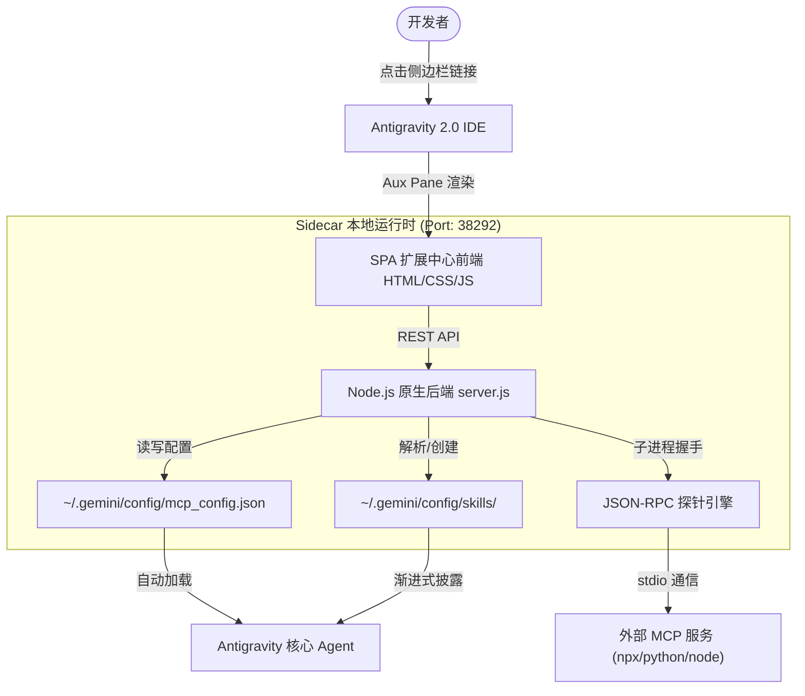

# Antigravity Skill & MCP Studio 🧩

<div align="center">

[](LICENSE)
[](https://github.com/google)
[](https://modelcontextprotocol.io/)
[](https://nodejs.org)
[](https://github.com)

**Google Antigravity 2.0 专属的侧边栏可视化扩展中心**  
*在 GUI 面板中直接配置、实时探针测试与管理 MCP 服务及 Agent Skills，彻底告别命令行手写 JSON 与目录配置！*

[功能特性](#-核心特性) · [快速上手](#-快速安装与使用) · [架构原理](#-技术架构) · [模版商城](#-预设模版商城) · [English](README.md)

<br/>


</div>

---

## 💡 为什么需要这个项目？

在日常使用 **Google Antigravity 2.0** 进行开发时，配置 MCP（Model Context Protocol）服务和 Agent Skills 往往面临以下痛点：

1. **手动编辑 JSON 极易出错**：需在 `~/.gemini/config/mcp_config.json` 中手写复杂的命令参数，反斜杠转义或标点符号遗漏会导致工具静默失效。
2. **缺乏状态探针与调试感知**：配置后无法直观得知服务是否成功启动、提供了哪些 Tools 工具集，遇到错误只能翻查系统底层日志。
3. **Skill 技能编写门槛高**：每次新增技能都要在本地创建深层文件夹、手动编写 YAML Frontmatter 头部元数据。

**Antigravity Skill & MCP Studio** 基于 Antigravity 官方 Sidecar UI 规范构建，直接在编辑器侧边栏抽屉内嵌入一个高颜值、易用的一站式管理工作台。

---

## ✨ 核心特性

### 🔌 1. MCP 服务可视化管理
* **纯 GUI 表单配置**：告别终端与 JSON 文件，在可视化界面中直接填写服务名称、选择运行时（`npx` / `python` / `node` / `uvx`）、配置参数与环境变量。
* **实时探针握手测试 (Live Probe Test)**：
  * 内置 JSON-RPC 探针引擎，一键在后台与服务完成 `initialize` 与 `tools/list` 握手通信。
  * 毫秒级反馈**响应延时**，直观展示服务所包含的**全部 Tools 工具清单及描述**。
* **即时生效**：保存后自动安全同步至 `mcp_config.json`，无需重启大模型即刻就绪。

### ⚡ 2. 智能体技能库 (Skills Studio)
* **全域技能自动发现**：自动聚合扫描全局技能（`~/.gemini/config/skills`）、系统内置技能以及当前工程工作区专属技能（`.agents/skills`）。
* **内置 Markdown 编排器**：无需手动建文件夹与排版 YAML 标头，在线填写技能用途描述与指令正文，自动完成规范化沉淀。
* **安全删除与归档**：针对自定义技能提供一键清理与移除，保护系统内置技能不被破坏。

### 🏪 3. 一键装机模版库 (Templates Store)
开箱即用，收集开发者最常用、最核心的生态模版，点击一键填充安装：
* **常用 MCP 服务**：
  * 🗄️ **SQLite Explorer**（本地数据库查询与表结构分析）
  * 📂 **Filesystem Access**（本地目录受控读写与代码检索）
  * 🐙 **GitHub Integration**（自动审查代码、提 PR / Issue 与查询仓库）
  * 🐬 **PostgreSQL Database**（远程/本地数据库模式探索与只读查询）
  * 🌐 **Fetch / Brave Search**（网页 Markdown 提取与互联网实时搜索）
  * 🖥️ **Puppeteer Browser**（自动化无头浏览器渲染与截屏）
  * 🧠 **Knowledge Graph Memory**（跨会话持久化知识图谱）
* **实用技能模版**：
  * 📊 **Code Review Pro**（多维度代码质量、坏味道与安全性审查）
  * 🧪 **Unit Test Generator**（自动化高覆盖率单元测试生成器）
  * 📝 **Smart Git Commit**（标准化 Conventional Commit 提炼指南）

---

## 🚀 快速安装与使用

### 环境要求
* 已安装 [Google Antigravity 2.0](https://github.com/google)
* 本地已安装 [Node.js](https://nodejs.org/)（>= 18.0）
* Python 3.x（用于运行一键安装脚本）

### 安装步骤

1. **克隆本仓库到本地**：
   ```bash
   git clone https://github.com/jokerzixi/antigravity-customization-hub.git
   cd antigravity-customization-hub
   ```

2. **执行一键挂载脚本**：
   ```bash
   python install.py
   ```
   *脚本会自动将本服务作为 Sidecar 插件注册至 `~/.gemini/config/sidecars/customization-hub`。*

3. **在 Antigravity 中启动与体验**：
   * 完全退出并**重启 Antigravity 2.0**，客户端会自动加载新注册的 Sidecar；
   * 在 Antigravity 对话框中随时点击链接呼出右侧侧边栏：  
     👉 **`[🧩 打开扩展中心](sidecar://customization-hub/)`**
   * *也可在浏览器中直接打开 `http://127.0.0.1:38292` 全屏访问。*

---

## 🛠️ 技术架构



* **零依赖后端**：`server.js` 基于纯 Node.js 标准库（`http`, `fs`, `child_process`, `os`）构建，开箱即跑，不污染开发环境。
* **原生主题契合**：前端界面采用 Antigravity 暗色系色彩规范，完美融入 IDE 原生设计风格。

---

## 📂 项目文件清单

| 文件/目录 | 说明 |
| :--- | :--- |
| [`sidecar.json`](sidecar.json) | Antigravity 2.0 官方 Sidecar UI 插件规范元数据 |
| [`server.js`](server.js) | 本地微服务（REST API、文件持久化、MCP 探针引擎） |
| [`public/`](public/) | 可视化管理面板单页应用（HTML5、CSS3、原生 JS 控制器） |
| [`assets/`](assets/) | 效果展示截图与图标资源 |
| [`install.py`](install.py) | 跨平台一键部署与卸载脚本 |
| [`LICENSE`](LICENSE) | MIT 开源许可证 |

---

## 🤝 参与贡献

欢迎提交 Issue 与 Pull Request！
* 提交新热门 MCP 服务模版：修改 `server.js` 中的 `PRESET_TEMPLATES.mcp`
* 提交新实用 Skill 模版：修改 `server.js` 中的 `PRESET_TEMPLATES.skills`

---

## 📄 开源许可证

本项目基于 [MIT License](LICENSE) 开源。
